<!-- ===================== BANNER ===================== -->
<p align="center">
  
</p>

<!-- ===================== TYPING INTRO ===================== -->
<p align="center">
  <a href="https://git.io/typing-svg">
    
  </a>
</p>

<p align="center">
  
  <a href="https://twitter.com/jawad_khalji"></a>
  <a href="https://github.com/jawaadullah?tab=followers"></a>
</p>

---

## 👨‍💻 About Me

```python
class JawadUllah:
    role      = "Software Engineering Undergraduate"
    university = "COMSATS University Islamabad 🇵🇰"
    focus     = ["Java", "C++", "Python", "Linux", "Cloud Computing"]
    learning  = ["Project Management", "System Design", "DSA"]
    hobbies   = ["Books 📚", "Movies 🎬", "Series 🍿", "Freelancing 💼"]

    def motto(self):
        return "Good code today, better tomorrow."
```

- 🌱 Currently learning **C++, Project Management, Linux & Cloud Computing**
- 💬 Ask me about **Java, Freelancing, Books, Movies, Series**
- 🚀 All my projects live in my **[Portfolio](https://sites.google.com/view/jawad-ullah-portfolio)**
- 📫 Reach me at **[byteofjawad@gmail.com](mailto:byteofjawad@gmail.com)**
- ⚡ Fun fact: **I debug with coffee and series in the background ☕**

---

## 🛠️ Tech Stack

<p align="center">
  
</p>

---

## 🌐 Connect With Me

<p align="center">
  <a href="https://linkedin.com/in/jawadkhanjullo"></a>
  <a href="https://twitter.com/jawad_khalji"></a>
  <a href="https://kaggle.com/jawaadkhaan"></a>
  <a href="https://www.hackerrank.com/byteofjawad"></a>
  <a href="https://www.leetcode.com/byteofjawad"></a>
  <a href="https://instagram.com/itxsantiiago"></a>
  <a href="https://fb.com/jawaddullah"></a>
  <a href="https://www.youtube.com/@jawadullah"></a>
  <a href="mailto:byteofjawad@gmail.com"></a>
  <a href="https://sites.google.com/view/jawad-ullah-portfolio"></a>
</p>

---

## 📊 GitHub Stats

<p align="center">
  
  
</p>

<p align="center">
  
</p>

<p align="center">
  
</p>

---

## 🐍 Contribution Snake

<p align="center">
  <picture>
    <source media="(prefers-color-scheme: dark)" srcset="https://raw.githubusercontent.com/jawaadullah/jawaadullah/output/github-snake-dark.svg" />
    <source media="(prefers-color-scheme: light)" srcset="https://raw.githubusercontent.com/jawaadullah/jawaadullah/output/github-snake.svg" />
    
  </picture>
</p>

---

<p align="center">
  <i>"First, solve the problem. Then, write the code."</i> 💡
</p>


